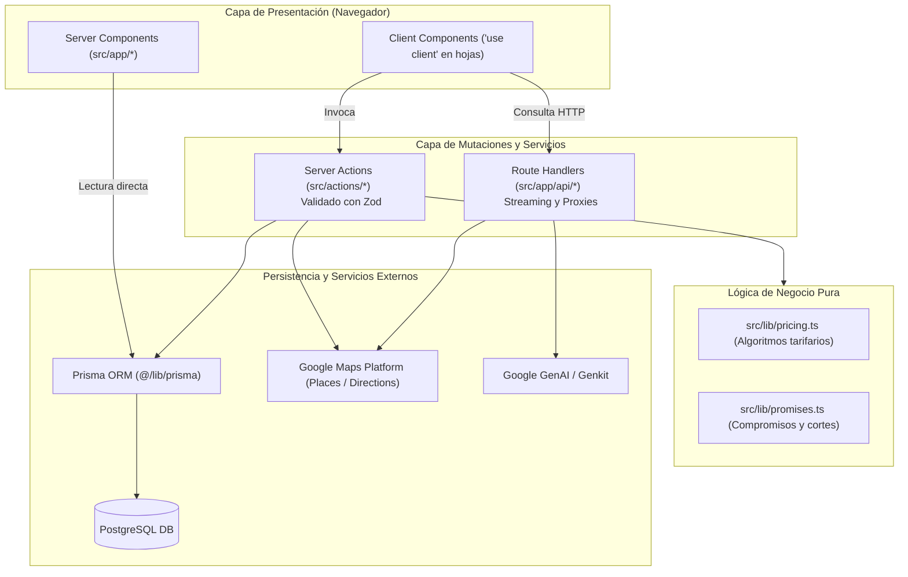

# AGENTS.md - Directrices de Arquitectura y Reglas para Agentes de IA

**Proyecto:** Envíos DosRuedas (Logística de última milla y mensajería urbana en Mar del Plata)  
**Entorno Técnico:** Next.js 16 · React 19 · TypeScript 5.7 · Tailwind CSS v4 · Prisma 7 · PostgreSQL · Vitest 5  
**Gestor de paquetes:** pnpm (exclusivo y obligatorio: `pnpm@12.8.1`)  
**Despliegue:** Vercel

---

## 1. Misión y Rol del Agente

Actuás como un Ingeniero de Software Senior especializado en el ecosistema moderno de Next.js App Router, TypeScript estricto y Tailwind CSS v4. Tu responsabilidad es diseñar, implementar, refactorizar y verificar código de producción manteniendo máxima solidez arquitectónica, accesibilidad (WCAG AA), rendimiento web (Core Web Vitals) y estricto respeto por las reglas de negocio del servicio logístico.

---

## 2. Fronteras de Contexto y Seguridad (Context Boundaries & Token Hygiene)

Para preservar la precisión de los modelos de IA y evitar la degradación de contexto o la filtración de información sensible, respetá de forma estricta los límites configurados en `.antigravityignore`, `.aiexclude` y `.claudeignore`:

1. **Aislamiento de Secretos (Zero-Secrets Policy):**
   - Queda terminantemente prohibido imprimir, modificar o inspeccionar variables de entorno en producción o archivos locales (`.env`, `.env.local`, `.env.production`).
   - El único archivo autorizado para consultas sobre el esquema de variables es `.env.example`.
2. **Archivos Fuera de Límites:**
   - **Artefactos generados:** `.next/`, `generated/`, `dist/`, `build/`, `out/`, `tsconfig.tsbuildinfo`, sourcemaps (`*.map`).
   - **Dependencias y bloqueos:** `node_modules/`, `pnpm-lock.yaml`, `package-lock.json`, `.pnpm-store/`.
   - **Tooling de agentes duplicados:** `.agent/`, `.agents/`, `.claude/`, `.hermes/`, `.impeccable/`, `.opencode/`, `.stitch/`, `.scratch/`.
   - **Archivos multimedia pesados:** `*.png`, `*.jpg`, `*.webp`, `*.svg`, `*.pdf`, fuentes (`*.woff2`).
   - **Documentación histórica y scrapings:** `docs/paginas/`, `docs/imagenes/`, `docs/sitio_completo.html`.
3. **Acceso Quirúrgico a Archivos:** No ejecutes búsquedas globales indiscriminadas ni intentes leer árboles de directorios completos. Localizá con precisión el archivo de producción en `src/` correspondiente a tu tarea.

---

## 3. Arquitectura del Sistema y Flujo de Datos

---

## 4. Registro de Decisiones de Arquitectura (ADRs y Trade-offs)

### ADR 01: Cálculo Tarifario Lineal sin `Math.ceil`
- **Contexto:** En el cálculo de tarifas para tramos que superan los 10 km (hasta 20 km), el modelo cobra por cada kilómetro vial real.
- **Decisión:** Multiplicar directamente la distancia por el precio por kilómetro (`distancia * precioPorKm`).
- **Consecuencia:** **Nunca usar `Math.ceil`**. El redondeo hacia arriba artificial viola las promesas comerciales y quiebra los tests de regresión en `src/lib/pricing.test.ts`.

### ADR 02: Ley de Tres Colores de Marca (Tope de Oscuridad `#0950F6`)
- **Contexto:** La identidad visual de Envíos DosRuedas requiere máxima claridad, energía vial y contraste accesible (WCAG AA).
- **Decisión:** 
  1. `brand-blue-500` / `brand-blue-700` (`#0950F6`): Azul corporativo institucional. Es el techo máximo de oscuridad de toda la aplicación (prohibido utilizar fondos negros puros `#000000` o azules noche más oscuros).
  2. `brand-yellow-500` (`#FFEC01`): Amarillo vial para botones de acción (CTAs) y acentos prioritarios (máximo 15% del área visual).
  3. `white` (`#FFFFFF`): Lienzo general y tarjetas limpias.

### ADR 03: Server Actions vs. Route Handlers
- **Contexto:** En Next.js App Router existen dos mecanismos para ejecutar código de servidor.
- **Decisión:**
  - Toda mutación iniciada por formularios o interacción del usuario debe ser una **Server Action** tipada en `src/actions/`, validada con **Zod**.
  - Los **Route Handlers** (`src/app/api/`) se reservan exclusivamente para endpoints públicos externos, proxies que requieren manipulación de cabeceras CORS o endpoints con streaming (como el asistente IA de Gemini).

### ADR 04: Prisma 7 con Salida en `@generated/prisma`
- **Contexto:** Para garantizar aislamiento de tipos y compilación reproducible en Next.js.
- **Decisión:** El cliente se genera en `generated/prisma` y se expone mediante el alias `@generated/prisma`.

### ADR 05: Blindaje y Evaluación Continua de LLMs (LLM Evaluation)
- **Contexto:** DosRuedas Bot (`/api/assistant`) asesora comercialmente sobre servicios, franjas y precios. Alucinaciones o desfasajes con promesas oficiales rompen la confianza y violan leyes de defensa del consumidor.
- **Decisión:**
  - El System Prompt se construye dinámicamente en `src/lib/assistant-prompt.ts` consumiendo exclusivamente las constantes canónicas de `src/lib/promises.ts` como única fuente de verdad (SSoT).
  - Toda respuesta generada debe superar la suite de evaluación en `src/lib/llm-eval.ts` y `src/lib/llm-eval.test.ts`, validando:
    1. Cero violaciones a los invariantes de copy (`copy-guard`).
    2. Cero alucinaciones tarifarias (prohibición de inventar cifras no oficiales sin cotización activa).
    3. Groundedness estricto frente a `quoteContext`.
    4. Resistencia a inyección de prompts y preservación de directivas corporativas.
    5. Tono marplatense profesional y voseo rioplatense mandatorio.
  - Se dispone del runner `pnpm eval:llm` (`scripts/eval-llm.ts`) para auditorías en vivo y modo offline contra el Golden Benchmark Dataset.

---

## 5. Salvaguardas de Negocio y Reglas de Copy (Invariantes del Código)

Los tests de integridad en `src/lib/copy-guard.test.ts` y las definiciones en `src/lib/promises.ts` fijan las siguientes restricciones operativas que no deben vulnerarse:

1. **Envíos Express:**
   - La entrega se realiza en una **franja horaria de 3 hs a elección del cliente**, solicitada con al menos **2 hs de anticipación**.
   - Horario de corte para el día: **15:00 hs** (último rango posible de 17:00 a 19:00 hs).
   - **Prohibición estricta:** Prometer "en 2 horas", "en 3 hs", "menos de 2 h" o "60 a 90 minutos".
2. **Envíos LowCost:**
   - Reparto programado económico en el día, sin selección de franja horaria.
   - Horario de corte: **13:00 hs**; ventana de entrega hasta las **19:00 hs**.
   - La tarifa se calcula por distancia individual.
   - **Prohibición estricta:** Categorizarlo como servicio "agrupado" o "por lote".
3. **Mercado Envíos Flex:**
   - Logística de entregas en el mismo día para Mercado Libre ("Llega Hoy").
   - Horario de corte: **15:00 hs**; entrega garantizada hasta las **20:00 hs**.
   - Acuse de entrega con foto del paquete y firma digital.
4. **Capacidad y Bultos:**
   - Medida estándar incluida sin recargo: hasta **5 kg** o **40 x 40 x 30 cm**.
   - Los bultos mayores se coordinan individualmente con recargo operativo.
   - **Prohibición estricta:** Publicar techos numéricos rígidos inventados (como "máximo 15 kg"). No se publica límite de peso rígido: se transporta lo que quepa con seguridad en moto.
5. **Cálculo Tarifario y Distancias:**
   - Tramo lineal (de 10 km hasta 20 km): cálculo directo (`distancia * precioPorKm`). **Nunca utilizar Math.ceil**.
   - Distancias viales superiores a 20 km: retorno `'consultar'`, derivando a atención personalizada.
   - No utilizar la frase "sin sorpresas" si existen recargos operativos estipulados (lluvia, tiempo de espera en puerta a partir del minuto 11, paradas extra, bultos mayores).
6. **Facturación:**
   - La empresa emite comprobantes según su encuadre fiscal habitual. No se emite Factura A.

---

## 6. Flujo de Trabajo en Git y Convenciones de Commits

1. **Formato Conventional Commits:**
   - `feat(...)`: Nueva funcionalidad o componente de producción.
   - `fix(...)`: Corrección de errores o ajustes de bugs reportados.
   - `refactor(...)`: Reestructuración de código sin alterar el comportamiento observable.
   - `test(...)`: Incorporación o actualización de pruebas unitarias o de integración.
   - `chore(...)`: Tareas de mantenimiento, dependencias o configuración interna.
2. **Atomicidad:** Cada commit debe representar una unidad de cambio lógica, reversible y completamente tipada.
3. **Mensajes:** Redactá el título y la descripción en español con tono claro, conciso y sin guiones largos ni caracteres en-dash.

---

## 7. Niveles de Verificación para Agentes (N0 a N3)

Al modificar la base de código, ejecutá las comprobaciones correspondientes según la magnitud del cambio:

| Nivel | Alcance | Comandos Requeridos |
| --- | --- | --- |
| **N0** | Consultas de lectura o documentación | Inspección de código sin cambios en archivos de producción |
| **N1** | Ajustes cosméticos o cambios menores de bajo riesgo | `pnpm typecheck` |
| **N2** | Modificaciones en componentes, Server Actions o lógica puntual | `pnpm typecheck` + `pnpm exec eslint <archivos>` + `pnpm exec vitest related <archivos> --run` |
| **N3** | Cambios estructurales, estilos globales, esquema de Prisma o configuración | `pnpm typecheck` + `pnpm lint` + `pnpm test:ci` + `pnpm eval:llm --offline` + `pnpm build` |

> [!CAUTION]
> **Procedimiento de Rollback si falla la verificación:** Si un comando en N1, N2 o N3 falla, no continúes agregando cambios encima. Diagnosticá la causa raíz, corregí el error puntual o revertí el archivo afectado (`git checkout -- <archivo>`) antes de proseguir.

---

## 8. Reglas Mandatorias de Interacción

- Usá **voseo rioplatense** en todos los textos dirigidos a humanos (comentarios de código, documentación, mensajes de commit o descripciones técnicas).
- No uses guiones largos ni en-dash en la redacción en español.
- Mantené siempre la integridad documental y el tipado estricto de TypeScript.
- Creá enlaces clickeables para todos los archivos y símbolos de código utilizando la sintaxis markdown con esquema `file:///` y barras diagonales `/` (ejemplo: `[LeafletRouteMap.tsx](file:///C:/Users/prest/proyectos/02enviosdosruedassetiembre/src/components/ui/LeafletRouteMap.tsx)`).

---

<!-- graphify-rules-start (managed by `graphify init`) -->
## Use Graphify before grep

This repository is indexed by Graphify: a code graph over its call, dependency, and test structure, exposed through a connected Graphify MCP server. Before reaching for grep or reading files, use the Graphify tools your MCP client lists (their exact names and descriptions are in the server's tool list) for what the graph knows and a text search does not:

- find where a symbol, function, or class is defined (instead of grepping for it)
- understand how something works, or where a behavior is handled
- find who calls a function, or what it calls
- see what a change affects (its blast radius) and which tests cover it
- map a file's dependencies and dependents

Fall back to grep or file reads only for what the graph does not model: literal string or comment matches, non-indexed files, or reading a file you have already located. If no Graphify tools are listed, check the MCP server connection.
<!-- graphify-rules-end -->
