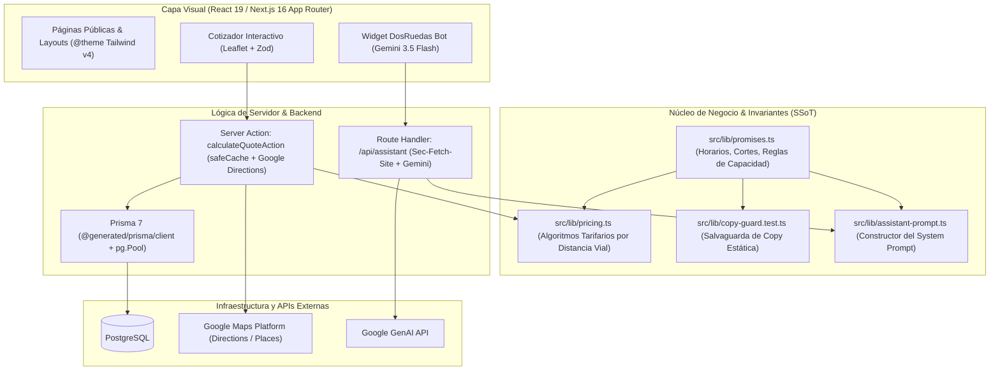

# CLAUDE.md

This file provides guidance to Claude Code (claude.ai/code) when working with code in this repository.

## 1. Comandos de Desarrollo y Verificación

Gestor de paquetes obligatorio: **pnpm** (`pnpm@12.8.1`). Queda prohibido el uso de `npm`, `yarn` o `bun`.

### Compilación y Servidor
```bash
pnpm dev              # Inicia servidor de desarrollo local (Next.js 16)
pnpm build            # Genera Prisma Client y compila producción (prisma generate && next build)
pnpm start            # Inicia servidor de producción compilado
pnpm clean            # Limpia caché de Next.js (.next/)
pnpm postinstall      # Genera cliente Prisma en generated/prisma
```

### Verificación Estática y Linter
```bash
pnpm typecheck        # Chequeo estricto de tipos TypeScript sin emitir archivos (tsc --noEmit)
pnpm lint             # Análisis estático completo con ESLint 9 Flat Config
pnpm exec eslint <archivo> # Ejecuta ESLint sobre un archivo específico
```

### Pruebas Automatizadas (Vitest)
```bash
pnpm test:ci          # Ejecuta toda la suite una sola vez (modo no interactivo)
pnpm test:ui          # Panel interactivo en navegador
pnpm exec vitest run <ruta-archivo> # Ejecuta un único archivo de test puntual
# Ejemplo: pnpm exec vitest run src/lib/pricing.test.ts
pnpm exec vitest run -t "<filtro>"  # Ejecuta pruebas que coincidan con el nombre/describe
pnpm exec vitest related <archivo> --run # Ejecuta pruebas afectadas por un archivo modificado
```
> [!IMPORTANT]
> **Nunca ejecutar `pnpm test` a secas** en entornos CLI/CI, ya que inicia Vitest en modo observador indefinido (watch mode). Usar siempre `pnpm test:ci` o añadir `run`.

### Evaluación de Inteligencia Artificial (LLM Eval)
```bash
pnpm eval:llm --offline # Corre evaluación con Golden Dataset y referencias sin requerir API keys
pnpm eval:llm           # Evaluación en vivo contra Gemini 3.5 Flash (requiere GEMINI_API_KEY)
```

### Scripts Auxiliares
```bash
pnpm pdf              # Genera reportes PDF locales vía script Python
pnpm pdf:prod         # Genera reportes PDF contra el entorno de producción
pnpm export:texts     # Extrae copys y textos del sitio
```

---

## 2. Arquitectura de Alto Nivel y Flujos Multicapa



### 2.1. Fuente Única de Verdad (SSoT) e Invariantes Comerciales
- **`src/lib/promises.ts`:** Centraliza todas las promesas operativas oficiales.
  - **Express:** `EXPRESS_WINDOW` ("franja horaria de 3 hs" a elección, nunca duración fija ni "en 2 horas"), con `EXPRESS_LEAD_TIME` ("2 hs de anticipación") y corte `15:00 hs` (último rango 17 a 19 hs).
  - **LowCost:** Reparto programado económico en el día; corte `13:00 hs`, entrega hasta `19:00 hs`. Cada viaje se cotiza individualmente (no es tarifa agrupada ni por lote).
  - **Mercado Envíos Flex:** Corte `15:00 hs`, entrega garantizada hasta `20:00 hs`. Acuse digital con foto y firma.
  - **Capacidad:** Bulto estándar incluido sin recargo de hasta `5 kg` (`STANDARD_WEIGHT_KG`) o `40 x 40 x 30 cm`. No existe un techo numérico rígido publicado (se coordina como bulto especial desde `BULK_EXTRA_FROM_ARS`).
  - **Facturación:** No se emite Factura A (solo Factura C y comprobantes estándar).
- **`src/lib/copy-guard.test.ts`:** Test estático que recorre `src/` e impide que ingresen al código afirmaciones prohibidas desmentidas por el dueño (como "15 kg", "60 a 90 min", "en 3 hs" o "Factura A").

### 2.2. Flujo de Cotización y Geolocalización
- El usuario ingresa origen y destino en el cotizador interactivo.
- Invoca la Server Action `calculateQuoteAction` (`src/actions/quote.ts`), la cual valida coordenadas con Zod.
- Consulta distancias viales reales mediante Google Directions con deduplicación por petición vía `safeCache` (`React.cache`).
- Computa tarifas en `src/lib/pricing.ts` mediante `calculateExpressPrice` y `calculateLowCostPrice`. Si la tabla `PriceRange` en base de datos está vacía, utiliza los tramos constantes de fallback (`EXPRESS_TIERS` y `LOW_COST_TIERS`).
- Para distancias viales mayores a 20 km (`MAX_AUTO_KM`), el cálculo automático retorna `'consultar'`.

### 2.3. Pipeline del Asistente Virtual y Evaluación LLM
- Endpoint `/api/assistant` (`src/app/api/assistant/route.ts`): Implementa verificación de cabeceras (`Sec-Fetch-Site`), valida esquema Zod y conecta con Google GenAI.
- `buildAssistantSystemPrompt` (`src/lib/assistant-prompt.ts`): Ensambla dinámicamente el System Prompt unificando las promesas de `promises.ts` junto con el `quoteContext` de la cotización activa en pantalla.
- `scripts/eval-llm.ts` y `src/lib/llm-eval.ts`: Conjunto de pruebas de regresión contra el Golden Benchmark Dataset evaluando coherencia con la cotización en pantalla, resistencia a inyecciones y salvaguardas de copy.

### 2.4. Persistencia y Cliente de Base de Datos
- **Prisma ORM 7:** Configurado con salida personalizada en `generated/prisma` (`prisma/schema.prisma`).
- **Instancia Centralizada (`src/lib/prisma.ts`):** Utiliza `@prisma/adapter-pg` con un pool de conexiones `pg.Pool`.
- Los tipos y el cliente se importan mediante el alias `@generated/prisma/client`. Tras cualquier cambio de esquema o clonación, ejecutar `pnpm postinstall`.

### 2.5. Sistema de Diseño (Ley de Tres Colores en Tailwind v4)
Definido en `src/app/globals.css` mediante directivas `@theme`:
- **Azul Corporativo (`#0950F6`):** Techo máximo de oscuridad en la interfaz (no usar fondos negros puros).
- **Amarillo Vial (`#FFEC01`):** Reservado estrictamente para CTAs principales y detalles de alta jerarquía (≤ 15% del área visual).
- **Blanco (`#FFFFFF`):** Fondo general y superficies limpias.
- **Jerarquía Tipográfica:** Anton (`font-display`, titulares), Bebas Neue (`font-subheading`, eyebrows y CTAs), Outfit (`font-sans`, párrafos y formularios), Geist Mono (`font-mono`, números tabulares y precios).

---

## 3. Higiene de Tokens y Límites del Repositorio

Para evitar degradación de contexto, respetar las exclusiones de `.claudeignore` y `.antigravityignore`:

1. **Uso Mandatorio de Graphify:** Al existir el índice `graphify-out/graph.json`, antes de inspeccionar masivamente archivos de código, utilizar las herramientas de Graphify (`graphify query "<pregunta>"`, `graphify explain "<concepto>"`, `graphify path "<origen>" "<destino>"` o los tools MCP `mcp__graphify__*`) para obtener contexto quirúrgico.
2. **Archivos Excluidos:**
   - Artefactos compilados y temporales: `.next/`, `generated/`, `dist/`, `build/`, `tsconfig.tsbuildinfo`.
   - Dependencias y bloqueos: `node_modules/`, `pnpm-lock.yaml`.
   - Tooling de agentes: `.agent/`, `.agents/`, `.claude/`, `.hermes/`, `.impeccable/`, `.opencode/`, `.scratch/`, `.stitch/`.
   - Archivos binarios y de diseño pesado: `*.webp`, `*.png`, `*.pdf`, `*.woff2`.
3. **Aislamiento Estricto de Secretos:** Prohibido leer, mostrar o editar archivos `.env` reales (`.env`, `.env.local`). Consultar variables únicamente en documentación o código fuente.

---

## 4. Convenciones de Código y Estilo

- **Voseo Rioplatense:** Todo texto dirigido a usuarios, documentación interna y mensajes debe redactarse en español rioplatense cordial (usando "vos").
- **Tipografía y Puntuación:** No utilizar guiones largos ni en-dash en redacciones en español; usar dos puntos, paréntesis o guion corto (`-`).
- **Referencias a Archivos:** Utilizar enlaces en formato markdown con esquema `file:///` y barras inclinadas `/` para archivos y líneas de código.
- **Server Actions:** Todas las acciones en `src/actions/` deben incluir `'use server'`, validar el payload con esquemas Zod y retornar tipos discriminados `{ success: true, data: T } | { success: false, error: string }`.
