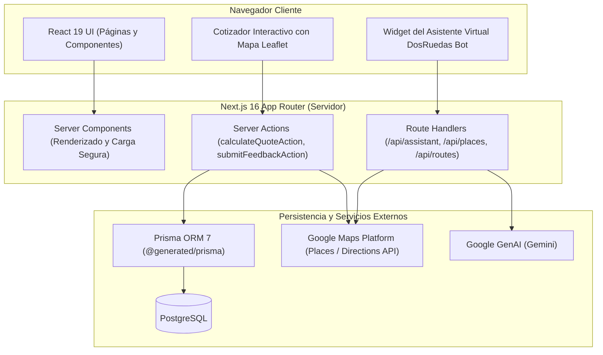

# Envíos DosRuedas

> Plataforma web de mensajería urbana en moto y logística de última milla para comercio electrónico en Mar del Plata, Argentina.

El sistema proporciona cotización online en tiempo real por distancia vial, contratación de envíos programados e inmediatos, logística integrada para vendedores de Mercado Envíos Flex, almacenamiento y fulfillment con picking y packing en base central (Friuli 1972), y un asistente virtual inteligente para atención comercial continua.

---

## Inicio Rápido (< 5 minutos)

Seguí estos pasos para levantar el entorno de desarrollo local en tu máquina:

### 1. Clonar el repositorio
```bash
git clone https://github.com/bomberoxenviosdosruedas/02enviosdosruedas.git
cd 02enviosdosruedas
```

### 2. Instalar dependencias con pnpm
```bash
pnpm install
```

### 3. Configurar variables de entorno
Copiá el archivo de ejemplo `.env.example` como `.env` y completá las credenciales requeridas:
```bash
cp .env.example .env
```
Campos indispensables para operar localmente:
- `DATABASE_URL`: Cadena de conexión a PostgreSQL.
- `GOOGLE_MAPS_API_KEY`: Clave de servidor para cálculo de rutas y direcciones.
- `NEXT_PUBLIC_GOOGLE_MAPS_API_KEY`: Clave pública para autocompletado y mapas interactivos.
- `GEMINI_API_KEY`: Clave de Google GenAI para el asistente virtual ("DosRuedas Bot").

### 4. Generar el cliente de Prisma e iniciar el servidor
```bash
pnpm postinstall
pnpm dev
```
La aplicación quedará disponible en `http://localhost:3000`.

---

## Arquitectura de Alto Nivel



---

## Stack Tecnológico

El proyecto está construido sobre un stack moderno, modular y tipado de punta a punta:

- **Framework Web:** Next.js 16.3 (`next@^16.3.6`) con App Router, Server Components y Server Actions
- **Biblioteca de Interfaz:** React 19 (`react@^19.3.0`, `react-dom@^19.3.0`)
- **Lenguaje:** TypeScript 5.7 (`typescript@5.7.3`) en modo estricto
- **Motor de Estilos:** Tailwind CSS v4 (`tailwindcss@4.3.3`, `@tailwindcss/postcss@4.3.3`)
- **Base de Datos y ORM:** PostgreSQL con Prisma 7 (`prisma@^7.10.0`, `@prisma/client@^7.10.0`, `@prisma/adapter-pg@^7.10.0`)
- **Inteligencia Artificial:** Google GenAI SDK (`@google/genai@^2.24.0`) y Genkit (`genkit@^1.42.0`, `@genkit-ai/google-genai@^1.42.0`)
- **Mapas y Geolocalización:** Google Maps Platform (Directions, Places Autocomplete y Details) con mapas livianos Leaflet (`leaflet@^1.9.4`)
- **Animaciones e Interacción:** Motion (`motion@^13.4.4`), Radix UI (`@radix-ui/react-accordion`, `@radix-ui/react-dialog`) y Lucide React (`lucide-react@^1.48.0`)
- **Validación de Datos:** Zod (`zod@^4.6.5`) y Hook Form Resolvers (`@hookform/resolvers@^5.9.1`)
- **Testing:** Vitest 5 (`vitest@^5.0.2`), jsdom (`jsdom@^30.1.1`) y Testing Library (`@testing-library/react@^16.3.3`)
- **Linter y Formato:** ESLint 9 (`eslint@9.21.0`, `eslint-config-next@16.3.6`) con Flat Config
- **Gestor de Paquetes:** pnpm 12 (`packageManager: pnpm@12.8.1`)
- **Métricas Web:** Vercel Speed Insights (`@vercel/speed-insights@^2.0.0`)

---

## Estructura del Proyecto (`src/`)

```
src/
├── actions/              # Server Actions ('use server') para mutaciones seguras
│   ├── quote.ts          # Cotización validada con Zod y Google Directions
│   ├── feedback.ts       # Registro de sugerencias en base de datos con Prisma
│   └── admin-imagenes.ts # Gestión y sugerencias asistidas por IA para metadatos
├── app/                  # Rutas y páginas de Next.js App Router
│   ├── (rutas públicas)/ # cotizar, servicios, cobertura, nosotros, contacto, guías
│   ├── admin/            # Panel administrativo interno
│   ├── api/              # Route Handlers para endpoints y proxies
│   │   ├── assistant/    # API del asistente virtual ("DosRuedas Bot") con Gemini
│   │   ├── places/       # Proxies seguros para Google Places (Autocomplete y Details)
│   │   └── routes/       # Proxy para Google Directions
│   ├── globals.css       # Definición de tokens de diseño @theme Tailwind v4
│   ├── layout.tsx        # Layout raíz con configuración de fuentes y SEO global
│   ├── sitemap.ts        # Generación dinámica del mapa del sitio
│   └── robots.ts         # Directivas de indexación para buscadores
├── assets/               # Recursos estáticos y fuentes locales
├── components/           # Componentes organizados por dominio y capa visual
│   ├── ui/               # Primitivas de diseño (DoubleBezelCard, CTANestedPill, InputField)
│   ├── layout/           # Cabecera (OptimizedHeader), footer y carrusel de redes
│   ├── home/             # Secciones de la página de inicio
│   ├── cotizar/          # Módulos del cotizador interactivo
│   ├── servicios/        # Secciones informativas por servicio logístico
│   └── nosotros/         # Vistas institucionales, preguntas frecuentes y canales
├── hooks/                # Custom hooks (cotización unificada, ruteo y analítica)
├── lib/                  # Lógica pura del negocio y clientes externos
│   ├── pricing.ts        # Algoritmos de cálculo tarifario y tramos por distancia
│   ├── promises.ts       # Constantes canónicas de horarios, límites y compromisos
│   ├── assistant-prompt.ts # Constructor dinámico y tipado del System Prompt unificado
│   ├── llm-eval.ts       # Framework de evaluación LLM, métricas deterministas y dataset
│   ├── prisma.ts         # Conexión centralizada de Prisma Client
│   ├── gemini.ts         # Cliente oficial de Google GenAI
│   ├── genkit.ts         # Configuración de Genkit
│   ├── whatsapp.ts       # Constructor de enlaces a WhatsApp con trazabilidad
│   ├── analytics.ts      # Registro de eventos y persistencia de parámetros UTM
│   └── utils.ts          # Fusión de clases CSS con clsx y tailwind-merge
└── test/                 # Configuración de entorno y extensiones para Vitest
```

---

## Servicios Logísticos y Reglas Operativas

1. **Envíos Express:**
   - Entrega en una **franja horaria de 3 hs a elección del cliente**, solicitada con al menos **2 hs de anticipación**.
   - Horario de corte para el mismo día: **15:00 hs** (último rango posible de 17:00 a 19:00 hs).
   - Cálculo tarifario automático por distancia vial hasta 20 km.
2. **Envíos LowCost:**
   - Reparto programado económico en el día, sin selección de franja horaria.
   - Horario de corte: **13:00 hs**; ventana de entrega hasta las **19:00 hs**.
   - Tarifa individual calculada por tramo de distancia.
3. **Mercado Envíos Flex:**
   - Logística para vendedores con entregas en el día ("Llega Hoy").
   - Horario de corte: **15:00 hs**; entrega garantizada hasta las **20:00 hs**.
   - Acuse de entrega con foto del paquete y firma digital.
4. **Depósito y Fulfillment:**
   - Almacenamiento, control por QR y despacho desde la base central en Friuli 1972.
   - Modalidad Same-Day y 24hs con opción de descuento DropOFF.
5. **Condiciones de Carga:**
   - Bulto estándar sin recargo: hasta **5 kg** o medidas de **40 x 40 x 30 cm**.
   - Paquetes de mayor porte se coordinan como bulto especial con recargo operativo.

---

## Referencia de Endpoints y Server Actions

### Route Handlers (`src/app/api/`)

| Ruta | Método | Descripción | Parámetros / Payload |
| --- | --- | --- | --- |
| `/api/assistant` | `POST` | Asistente conversacional IA sobre servicios y tarifas | `{ messages: [{ role: 'user', content: string }] }` |
| `/api/places/autocomplete` | `GET` | Autocompletado de direcciones en Mar del Plata | Query param: `?input=Friuli+1972` |
| `/api/places/details` | `GET` | Obtención de coordenadas geográficas de un `place_id` | Query param: `?place_id=...` |
| `/api/routes/directions` | `GET` | Cálculo de distancia vial y geometría de ruta en moto | Query params: `?origin=lat,lng&destination=lat,lng` |

### Server Actions Principales (`src/actions/`)

- **`calculateQuoteAction`** (`src/actions/quote.ts`):
  Valida origen y destino con Zod, calcula distancia vial vía Google Directions y computa tarifas lado a lado para Express y LowCost respetando las reglas de tramos lineales y límites de 20 km.
- **`submitFeedbackAction`** (`src/actions/feedback.ts`):
  Permite registrar reportes o correcciones de contenido directamente en la base de datos PostgreSQL.

---

## Sistema de Diseño y Marca

La identidad visual está regida por la Ley de Tres Colores definida en `src/app/globals.css`:

- **Azul Corporativo:** `#0950F6` (`brand-blue-500` / `brand-blue-700`). Es el techo máximo de oscuridad permitido en la interfaz. No se utilizan fondos negros puros ni azules noche más oscuros.
- **Amarillo Vial:** `#FFEC01` (`brand-yellow-500`). Reservado estrictamente para botones de acción principal (CTAs) y detalles de alta jerarquía (máximo 15% del área visual).
- **Blanco:** `#FFFFFF` (`white`). Fondo general y superficies limpias.
- **Tipografías Oficiales:**
  - `Anton` (`font-display`): Títulos de impacto en mayúsculas.
  - `Bebas Neue` (`font-subheading`): Subtítulos, eyebrows y llamados a la acción.
  - `Outfit` (`font-sans`): Lectura general, párrafos y formularios.
  - `Geist Mono` (`font-mono`): Precios, distancias y métricas con números tabulares.

---

## Scripts Disponibles en `package.json`

| Script | Comando Real | Propósito |
| --- | --- | --- |
| `pnpm dev` | `next dev` | Inicia el entorno de desarrollo local con recarga en caliente |
| `pnpm build` | `prisma generate && next build` | Genera Prisma Client y compila la aplicación para producción |
| `pnpm start` | `next start` | Inicia el servidor optimizado de producción |
| `pnpm lint` | `eslint .` | Inspecciona el código mediante ESLint con flat config |
| `pnpm typecheck` | `tsc --noEmit` | Ejecuta la verificación estricta de tipos de TypeScript |
| `pnpm clean` | `next clean` | Limpia los directorios temporales de compilación de Next.js |
| `pnpm postinstall` | `prisma generate` | Genera los tipos tipados de Prisma en `generated/prisma` |
| `pnpm test` | `vitest` | Inicia Vitest en modo interactivo (watch mode) |
| `pnpm test:ci` | `vitest run` | Ejecuta la suite de pruebas unitarias una sola vez |
| `pnpm test:ui` | `vitest --ui` | Abre el panel visual de pruebas en el navegador |
| `pnpm eval:llm` | `tsx scripts/eval-llm.ts` | Ejecuta la suite de evaluación de LLM (Golden Dataset y métricas) |
| `pnpm pdf` | `python scripts/generate_page_pdf.py` | Genera capturas y reportes PDF vía script local |
| `pnpm pdf:prod` | `python scripts/generate_page_pdf.py --url https://enviosdosruedas.com` | Genera reportes PDF apuntando a producción |
| `pnpm export:texts` | `python scripts/extract_site_texts.py` | Extrae textos y copys de las vistas del sitio |

---

## Evaluación y Blindaje de IA (LLM Evaluation)

El asistente virtual ("DosRuedas Bot") cuenta con una infraestructura de evaluación sistemática para garantizar cero alucinaciones y estricto respeto a las promesas comerciales:

- **Fuente Única de Verdad (SSoT):** El System Prompt (`src/lib/assistant-prompt.ts`) se genera dinámicamente a partir de `src/lib/promises.ts`.
- **Métricas Automatizadas:** Validación en cada cambio de:
  - Invariantes de copy (`copy-guard`: franja horaria de 3 hs, corte 15:00 hs, estándar 5 kg sin techo rígido, no Factura A, no inventar tarifas).
  - Fidelidad contextual (*Groundedness*) frente a cotizaciones activas en pantalla.
  - Resistencia a inyecciones de prompt (*Prompt Injection Defense*).
  - Voseo y tono marplatense cordial.
- **Ejecución de la Suite:**
  ```bash
  # Modo offline (valida referencias canónicas y pipeline sin requerir API keys externas)
  pnpm eval:llm --offline

  # Modo live (ejecuta llamadas contra Gemini 3.5 Flash si GEMINI_API_KEY está configurada)
  pnpm eval:llm
  ```

---

## Guía de Contribución y Flujo de Trabajo

1. **Ramas de Trabajo:** Creá una rama descriptiva a partir de la rama principal (`git checkout -b feat/nueva-funcionalidad` o `git checkout -b fix/ajuste-tarifa`).
2. **Formato de Commits (Conventional Commits):**
   - `feat(...)`: Nueva funcionalidad o componente.
   - `fix(...)`: Corrección de errores o bugs.
   - `refactor(...)`: Mejoras de código sin cambiar funcionalidad externa.
   - `test(...)`: Incorporación o actualización de pruebas.
   - `chore(...)`: Tareas de mantenimiento o configuración.
3. **Comprobación Previa Obligatoria:** Antes de abrir un Pull Request o enviar cambios a producción, verificá que los tipos y pruebas pasen sin errores:
   ```bash
   pnpm typecheck && pnpm test:ci
   ```
