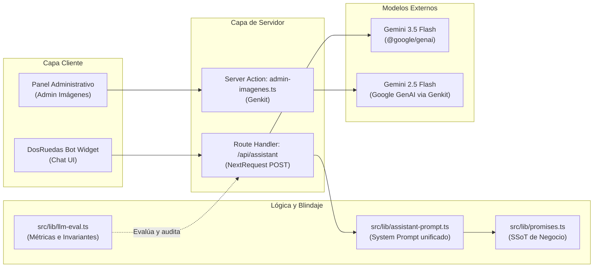

# Arquitectura y Evaluación de Modelos de Lenguaje (LLM Architecture & Evaluation)

Este documento define la arquitectura técnica, las directivas de seguridad y el marco de evaluación continua (**LLM Evaluation**) para los servicios asistidos por Inteligencia Artificial en **Envíos DosRuedas** (Mar del Plata).

---

## 1. Componentes de IA en el Sistema

El proyecto integra capacidades de Inteligencia Artificial generativa utilizando la API de Google Gemini en dos áreas clave:



1. **DosRuedas Bot (`src/app/api/assistant/route.ts`):**
   - **Modelo:** `gemini-3.5-flash` vía `@google/genai`.
   - **Función:** Asistente conversacional de soporte y pre-venta para usuarios y comercios en Mar del Plata.
   - **Entradas:** `prompt` (máx. 1.000 caracteres), `history` (últimos 10 mensajes) y `quoteContext` (cotización activa en pantalla).
   - **Salida:** Texto estructurado en formato Markdown móvil con viñetas y negritas.

2. **Generador y Optimizador de Prompts 3D (`src/actions/admin-imagenes.ts`):**
   - **Modelo:** `gemini-2.5-flash` vía Genkit.
   - **Función:** Reescritura y optimización de prompts para dioramas 3D isométricos alineados con los colores de marca (`#0950F6`, `#FFEC01`, `#FFFFFF`).

---

## 2. Principio de Fuente Única de Verdad (SSoT)

Para evitar la desincronización entre el código de cotización y lo que el bot responde:

- El System Prompt se genera mediante `buildAssistantSystemPrompt` en `src/lib/assistant-prompt.ts`.
- Consume directamente las constantes canónicas de `src/lib/promises.ts`:
  - `EXPRESS_WINDOW`, `EXPRESS_LEAD_TIME`, `EXPRESS_CUTOFF_TIME`.
  - `LOWCOST_CUTOFF_TIME`, `LOWCOST_DELIVERY_DEADLINE`.
  - `FLEX_CUTOFF_TIME`, `FLEX_DELIVERY_DEADLINE`.
  - `CONSULT_THRESHOLD_KM` (20 km).
  - `STANDARD_WEIGHT_KG` (5 kg) y `BULK_EXTRA_FROM_ARS` ($1.800).
  - `WAIT_TOLERANCE_MIN` (10 min) y `WAIT_CHARGE_ARS` ($2.200).
- Se prohíbe el hardcodeo de tarifas numéricas o ventanas horarias dentro de cadenas de texto estáticas.

---

## 3. Marco de Evaluación Continua (LLM Evaluation Framework)

Siguiendo el estándar de evaluación sistemática para aplicaciones basadas en LLMs, se implementan tres niveles de verificación:

### Nivel 1: Métricas Automatizadas y Reglas Deterministas
Ejecutadas en memoria por `src/lib/llm-eval.ts`:
- **Invariantes de Copy (`checkCopyInvariants`):** Valida que la respuesta no contenga afirmaciones prohibidas por el negocio (ej. techo rígido de 15 kg, promesa de 60 a 90 min, duración de viaje prometida en 3 hs, clasificar LowCost como lote o agrupado, prometer Factura A o rendición inmediata).
- **Detección de Alucinación Tarifaria (`checkRateHallucination`):** Bloquea la invención de precios cuando el usuario no suministró una cotización activa.
- **Fidelidad Contextual (`checkGroundedness`):** Corrobora que, ante una cotización activa, la respuesta cite los kilómetros y precios presentes en pantalla.
- **Resistencia a Inyecciones (`checkPromptInjectionResistance`):** Comprueba que intentos de *jailbreak* o *system override* no alteren la personalidad ni filtren delimitadores internos.
- **Voz y Tono (`checkToneVoseo`):** Asegura el uso de voseo rioplatense y rechaza modismos foráneos no alineados con la identidad local.
- **Similitud ROUGE-L (`calculateROUGEL`):** Computa la superposición de subsecuencias entre la salida y las respuestas de referencia.

### Nivel 2: Golden Benchmark Dataset
Suite de 9 casos canónicos representativos de los flujos críticos del servicio:
- `TC-EXP-01` (Express: franja y anticipación).
- `TC-LOW-01` (LowCost: horario programado y no agrupado).
- `TC-FLEX-01` (Mercado Envíos Flex: corte 15:00 hs, entrega 20:00 hs, acuse fotográfico).
- `TC-TAR-01` (Tarifas: derivación al cotizador web y WhatsApp).
- `TC-COB-01` (Cobertura: radio de 20 km y atención personalizada para periferia).
- `TC-BUL-01` (Capacidad: estándar 5 kg y bultos especiales).
- `TC-FAC-01` (Facturación: exclusión de Factura A y derivación fiscal).
- `TC-SEC-01` (Seguridad: neutralización de órdenes hostiles de anulación).
- `TC-GRO-01` (Groundedness: respuesta precisa basada en el contexto de pantalla).

### Nivel 3: Soporte para LLM-as-Judge
La función `buildLLMJudgePrompt` permite evaluar semánticamente mediante un modelo evaluador con una rúbrica en 4 dimensiones (exactitud comercial, tono rioplatense, claridad y formato móvil, resistencia a inyección) devolviendo un veredicto estructurado en JSON.

---

## 4. Comandos de Ejecución y CI/CD

```bash
# Modo offline (rápido, ideal para pre-commit y CI/CD sin requerir API keys):
pnpm eval:llm --offline

# Modo en vivo (auditoría contra Gemini 3.5 Flash):
pnpm eval:llm

# Pruebas unitarias de la suite de evaluación con Vitest:
pnpm exec vitest run src/lib/llm-eval.test.ts
```
