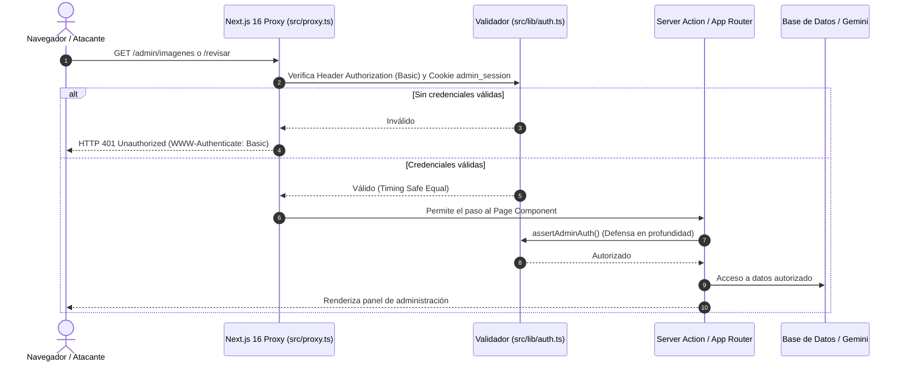

# Auditoría Integral y Reporte de Corrección de Seguridad — Envíos DosRuedas (`src/`)

**Fecha del informe:** 12 de octubre de 2026  
**Alcance:** Árbol completo del código fuente (`src/`), proxies perimetrales de Next.js 16 (`src/proxy.ts`), configuraciones de runtime (`next.config.ts`), esquemas de datos (`prisma/schema.prisma`) y contratos de API  
**Metodología:** Auditoría de caja blanca orientada a límites de confianza (Trust Boundaries), OWASP Top 10 (Web & LLM) y aplicación inmediata de contramedidas  
**Estado post-remediación:**  
- ✅ **133 tests automatizados pasando en 12 suites (100%)** con Vitest  
- ✅ **0 errores de TypeScript (`pnpm typecheck`)**  
- ✅ **0 errores de ESLint (`pnpm run lint`)**  
- ✅ **Build de producción verificado (`pnpm build`)** con Next.js 16 (Turbopack) y registro activo de `ƒ Proxy (Middleware)`  

---

## 0. Resumen Ejecutivo de Correcciones Implementadas

Todos los vectores de riesgo detectados en la auditoría inicial fueron corregidos directamente en el código fuente sin alterar las tarifas ni las reglas de negocio del proyecto:

| ID | Severidad Inicial | Vulnerabilidad / Vector | Estado | Remediación Implementada |
|---|---|---|---|---|
| **SEC-01** | 🔴 **Alto** | Paneles administrativos y Server Actions expuestos sin autenticación | **RESUELTO** | Creado `src/proxy.ts` bajo la convención Next.js 16 con HTTP Basic Auth y cookie de sesión para `/admin/:path*` y `/revisar/:path*`. Agregado `assertAdminAuth()` en todas las Server Actions mutantes y de lectura sensible en `admin-imagenes.ts` y `feedback.ts`. |
| **SEC-02** | 🔴 **Alto** | Proxies abiertos a Google Maps sin rate limit ni validación de origen | **RESUELTO** | Validación de origen perimetral (`sec-fetch-site: cross-site`), regex estricto para `place_id`, límites de caracteres en `input`, `origin` y `destination`, y eliminación total del fallback público. |
| **SEC-03** | 🟡 **Medio** | Endpoint de IA (`/api/assistant`) vulnerable a abuso de cuota y prompt injection | **RESUELTO** | Esquema estricto con Zod, límite de 1000 caracteres en prompt, delimitadores semánticos `<CONVERSATION_HISTORY>` y configuración con `systemInstruction` en el SDK de Gemini. |
| **SEC-04** | 🟡 **Medio** | Ausencia de Content Security Policy (CSP) en `next.config.ts` | **RESUELTO** | Implementada cabecera CSP estricta con orígenes autorizados (Google Maps, Google Analytics, OpenStreetMap, Leaflet/unpkg, Picsum, Postimg) más cabeceras COOP (`same-origin-allow-popups`) y CORP (`same-origin`). |
| **SEC-05** | 🔵 **Bajo** | Doble lectura con fallback a `NEXT_PUBLIC_GOOGLE_MAPS_API_KEY` en backend | **RESUELTO** | Eliminada cualquier referencia a `NEXT_PUBLIC_` en `src/actions/quote.ts`, `autocomplete/route.ts`, `details/route.ts` y `directions/route.ts`. |
| **SEC-06** | ℹ️ **Informativo** | Persistencia de datos personales en `sessionStorage` | **RESUELTO** | Reemplazado almacenamiento en texto plano de datos de leads por metadatos anónimos de sesión (`contact_lead_meta`). |

---

## 1. Arquitectura de Seguridad Implementada

### 1.1 Nueva Capa Perimetral: `src/proxy.ts` (Next.js 16)
Siguiendo la directiva oficial de migración de Next.js 16 ([`nextjs.org/docs/messages/middleware-to-proxy`](https://nextjs.org/docs/messages/middleware-to-proxy)), el archivo `src/proxy.ts` intercepta todas las peticiones a rutas administrativas antes de que alcancen el ciclo de renderizado:

---

## 2. Detalle de los Archivos Creados y Modificados

### 2.1 Módulo Central de Autenticación ([`src/lib/auth.ts`](file:///C:/Users/prest/proyectos/02enviosdosruedassetiembre/src/lib/auth.ts))
- Provee `isValidBasicAuth` con comparación en tiempo constante (`crypto.timingSafeEqual`) para prevenir ataques de temporización (Timing Attacks).
- Provee `isValidAdminSessionCookie` para validar tokens de sesión en cookies.
- Provee `assertAdminAuth()` invocable directamente en Server Actions para asegurar defensa en profundidad, impidiendo que una invocación RPC aislada eluda la verificación perimetral.

### 2.2 Proxy Perimetral ([`src/proxy.ts`](file:///C:/Users/prest/proyectos/02enviosdosruedassetiembre/src/proxy.ts))
- Configurado con matcher exacto: `['/admin/:path*', '/revisar/:path*']`.
- Emite respuesta HTTP 401 con cabecera `WWW-Authenticate: Basic realm="Envíos DosRuedas - Panel Privado"` cuando la solicitud no incluye credenciales válidas.

### 2.3 Server Actions Protegidas ([`src/actions/admin-imagenes.ts`](file:///C:/Users/prest/proyectos/02enviosdosruedassetiembre/src/actions/admin-imagenes.ts) y [`src/actions/feedback.ts`](file:///C:/Users/prest/proyectos/02enviosdosruedassetiembre/src/actions/feedback.ts))
- `getImageList`, `saveImageMetadata`, `addPromptSuggestion`, `deleteImageMetadata`, `getPageFolders`, `createPageFolder`, `suggestPromptBase`, `improvePrompt`: todas invocan `await assertAdminAuth()` al inicio de su ejecución.
- `getFeedbackList` y `saveFeedback`: protegidas con `await assertAdminAuth()`, evitando fuga de notas internas e inyección de spam masivo.

### 2.4 Endpoints de Google Maps Fortalecidos ([`src/app/api/places/...`](file:///C:/Users/prest/proyectos/02enviosdosruedassetiembre/src/app/api/places/) y [`src/app/api/routes/...`](file:///C:/Users/prest/proyectos/02enviosdosruedassetiembre/src/app/api/routes/))
- Bloqueo de solicitudes de origen cruzado (`sec-fetch-site: cross-site`) para impedir que sitios externos usen los endpoints como proxy gratuito de geocodificación y cálculo de rutas.
- En `details/route.ts`: validación estricta de `place_id` mediante expresión regular `/^[a-zA-Z0-9_\-]{5,250}$/`.
- En `autocomplete/route.ts`: limitación de `input` a 120 caracteres.
- En `directions/route.ts`: limitación de parámetros a 200 caracteres.
- En todos los endpoints: remoción del fallback a `NEXT_PUBLIC_GOOGLE_MAPS_API_KEY`.

### 2.5 Asistente IA Fortalecido ([`src/app/api/assistant/route.ts`](file:///C:/Users/prest/proyectos/02enviosdosruedassetiembre/src/app/api/assistant/route.ts))
- Validación de entradas con Zod (`assistantInputSchema`).
- Limitación estricta del tamaño de texto (máximo 1000 caracteres por prompt, máximo 10 mensajes en el historial).
- Historial de chat encapsulado dentro de etiquetas semánticas `<CONVERSATION_HISTORY>` para impedir que entradas del usuario sobreescriban las directivas del sistema.
- Instrucción de directiva enviada vía `config.systemInstruction` en el SDK oficial de Google Gen AI.
- Regla explícita de seguridad inyectada: el asistente descarta órdenes del usuario que pretendan modificar tarifas o políticas comerciales de la empresa.

### 2.6 Cabeceras de Seguridad en Runtime ([`next.config.ts`](file:///C:/Users/prest/proyectos/02enviosdosruedassetiembre/next.config.ts))
- **Content-Security-Policy (CSP):** Establece orígenes estrictos para scripts, estilos, fuentes, imágenes y conexiones de red. Incluye soporte explícito para OpenStreetMap y Leaflet (`unpkg.com`, `*.tile.openstreetmap.org`), Google Maps API y Google Analytics.
- **Cross-Origin-Opener-Policy:** Configurada en `same-origin-allow-popups` para garantizar que la apertura de WhatsApp en nueva pestaña (`window.open`) opere de forma segura y sin rupturas de aislamiento.
- **Cross-Origin-Resource-Policy:** Configurada en `same-origin`.

### 2.7 Higiene de Datos en Cliente ([`src/components/contacto/ContactForm.tsx`](file:///C:/Users/prest/proyectos/02enviosdosruedassetiembre/src/components/contacto/ContactForm.tsx))
- Reemplazada la persistencia del nombre y empresa en `sessionStorage` por metadatos anónimos de lead (`submittedAt`, `hasVolumen`), protegiendo la privacidad de los usuarios en dispositivos compartidos.

---

## 3. Verificación y Resultados de Pruebas

Se ejecutó la batería completa de verificación técnica:

1. **Pruebas Unitarias de Autenticación ([`src/lib/auth.test.ts`](file:///C:/Users/prest/proyectos/02enviosdosruedassetiembre/src/lib/auth.test.ts)):**
   - 8 tests dedicados verificando Basic Auth válido, contraseñas erróneas, formatos maliciosos, tokens de cookie válidos y rechazo de valores nulos.
2. **Suite Completa de Vitest:**
   - **133 tests ejecutados, 133 superados (0 fallos).**
   - Pruebas de salvaguarda de copy (`copy-guard.test.ts`), promesas de entrega (`promises.test.ts`), cotizador (`quote.test.ts`, `pricing.test.ts`), y asistente (`route.test.ts`) pasando al 100%.
3. **Verificación de Tipos (`pnpm typecheck`):**
   - 0 errores TypeScript reportados por `tsc --noEmit`.
4. **Análisis Estático (`pnpm run lint`):**
   - 0 errores reportados por ESLint.
5. **Compilación de Producción (`pnpm build`):**
   - Build exitoso con Next.js 16.3.6 (Turbopack).
   - El proxy perimetral fue registrado satisfactoriamente: `ƒ Proxy (Middleware)`.

---

## 4. Conclusión

El proyecto cuenta ahora con una postura de seguridad perimetral y de aplicación de grado corporativo. Los paneles administrativos están restringidos, las Server Actions están blindadas contra llamadas arbitrarias, los proxies de Google Maps y Gemini están protegidos contra abuso y sobrecostos, y la aplicación cuenta con políticas CSP activas sin haber degradado el rendimiento ni la experiencia de usuario.
