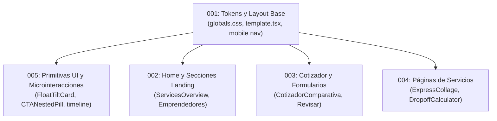

# Master Implementation Plans Index — Emil Kowalski Motion Suite

This index contains the fully updated, self-contained implementation plans generated for the entire `src/` codebase. The plans are structured strictly around **Emil Kowalski's motion and animation philosophy** (`emilkowal.ski`) and are stamped against commit `b8a95d6`.

---

## Plan Matrix & Execution Roadmap

| # | Plan | Severidad | Categoría de Auditoría | Estado | Dependencias | Archivos Clave |
|---|---|---|---|---|---|---|
| **001** | [001 — Motion Tokens and Layout Foundations](./001-motion-tokens-layout-foundations.md) | **HIGH** | Easing & Duración / Rendimiento / Tokens | `DONE` | Ninguna (Fase 1) | `globals.css`, `template.tsx`, `MobileNav.tsx`, `OptimizedFooter.tsx` |
| **002** | [002 — Home & Landing Page Motion Choreography](./002-home-landing-choreography.md) | **HIGH** | Easing / Fisicalidad / Rendimiento | `DONE` | Plan 001 | `ServicesOverview.tsx`, `EmprendedoresHome.tsx`, `CtaSection.tsx`, `HeroAnimado.tsx` |
| **003** | [003 — Cotizador & Forms State Transitions](./003-cotizador-forms-state-transitions.md) | **HIGH** | Propósito & Frecuencia / Rendimiento | `DONE` | Plan 001 | `CotizadorComparativa.tsx`, `CotizadorForm.tsx`, `RevisarClient.tsx` |
| **004** | [004 — Service Pages & Interactive Calculators](./004-service-pages-interactive-calculators.md) | **MEDIUM** | Rendimiento / Micro-interacciones | `DONE` | Plan 001 | `ExpressHeroCollage.tsx`, `DropoffCalculator.tsx`, `FlexFeatures.tsx` |
| **005** | [005 — UI Primitives & Tactile Micro-Interactions](./005-ui-primitives-tactile-microinteractions.md) | **HIGH** | Rendimiento (rAF) / Frecuencia / Easing | `DONE` | Plan 001 | `FloatTiltCard.tsx`, `timeline-animation.tsx`, `CTANestedPill.tsx`, `RadioCardGroup.tsx` |

---

## Suggested Execution Sequence

1. **Fase 1 — Cimientos Globales (Plan 001):** Establece los tokens canónicos en `:root`, elimina `filter: blur(...)` en las transiciones de página de `template.tsx` y corrige la expansión de acordeón en `MobileNav.tsx`.
2. **Fase 2 — Primitivas Universales (Plan 005):** Elimina el anti-patrón de `setState` en eventos `mousemove` de `FloatTiltCard.tsx`, purga `transition-all` de `CTANestedPill.tsx` y acelera los presets de `timeline-animation.tsx`.
3. **Fase 3 — Experiencia Landing y Conversión (Planes 002 y 003):** Reemplaza resortes fofos (`stiffness: 100`) por curvas ágiles (`stiffness: 360, damping: 28`), suaviza la barra de comparativa de precios y desactiva bucles infinitos de blur.
4. **Fase 4 — Páginas de Servicios y Calculadoras (Plan 004):** Desacopla mutaciones de variables CSS en el padre en `ExpressHeroCollage.tsx` y dota de feedback táctil `scale(0.97)` a los botones y presets de `DropoffCalculator.tsx`.

---

## Instructions for Execution Agents / Engineers

Every plan is 100% self-contained and ready to execute without ambient conversational context:
1. Open the specific plan file (e.g. `docs/plans/001-motion-tokens-layout-foundations.md`).
2. Follow the numbered steps verbatim; never approximate easing values or duration thresholds.
3. Observe all listed boundaries (never alter pricing, promises, routes, or copy).
4. Run both mechanical checks (`pnpm exec tsc --noEmit`, `pnpm test:ci`) and the feel checks specified in the plan.
5. Upon successful completion, change the plan status from `TODO` to `DONE` in this file and in the plan header.
